# 웹앱 1차 — 바뀐 화면 시안 (2판)

- 화면에는 웹앱에 실제로 보일 것만 그렸습니다. 무엇이 바뀌는지는 화면 아래 글에 있습니다.
- 탭 · 단계 이름은 지금 웹앱의 영어 그대로입니다. 한글로 바꾼 꼴은 맨 아래에 견줘 두었습니다.
- 1판에서 뺀 것: 화면 안의 '새로' 띠 · 점선 · 템플릿 아이콘 · 템플릿 고르는 칸(템플릿이 하나라 지금은 숨김).
- 옵션은 지금 웹앱 그대로입니다(접힌 칸). 펼치면 '원고 확인' 줄만 빠집니다.
- 그림 속 작업 · 글 · 사람은 모두 지어낸 예시입니다.

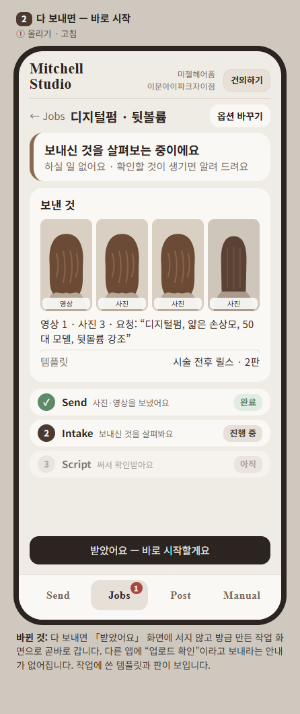

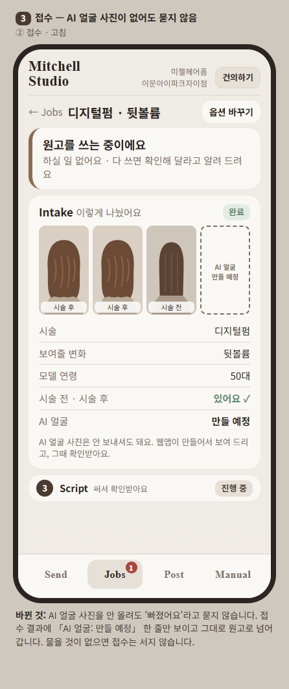

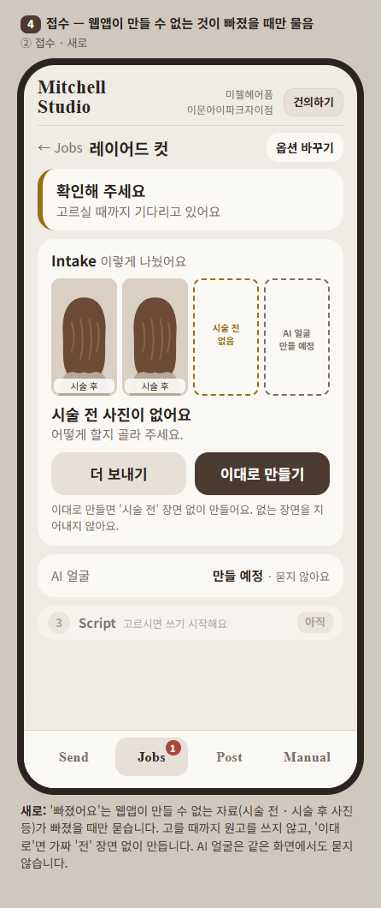

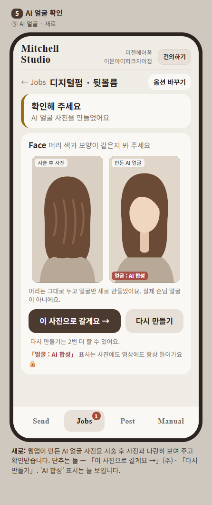

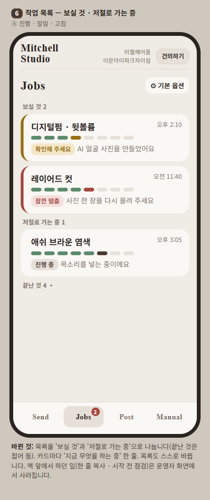

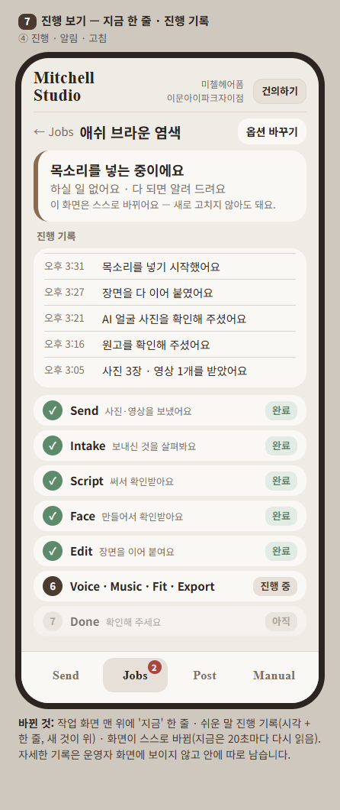

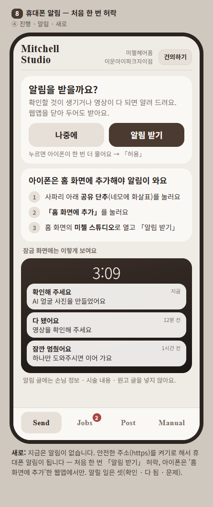

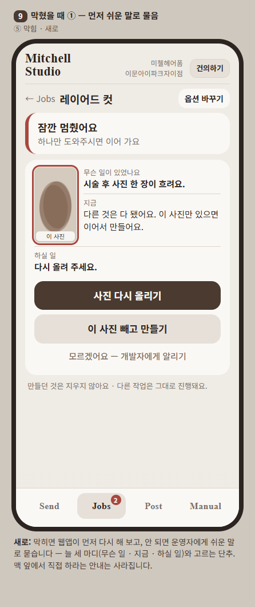

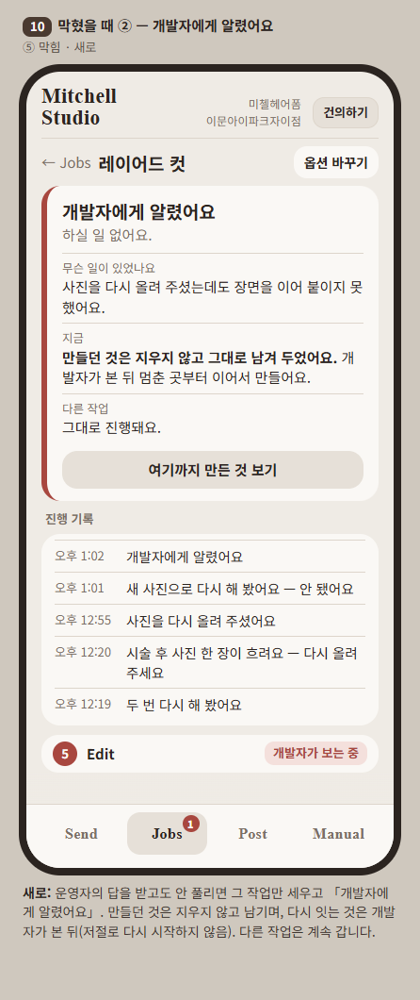

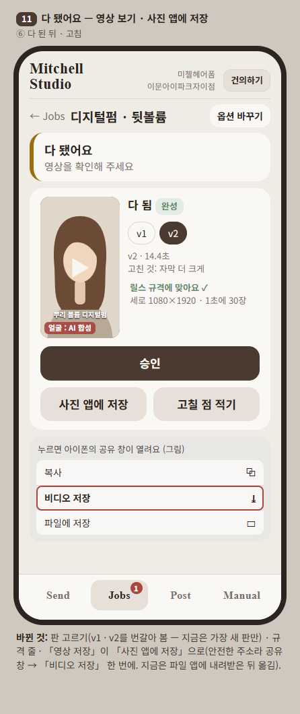

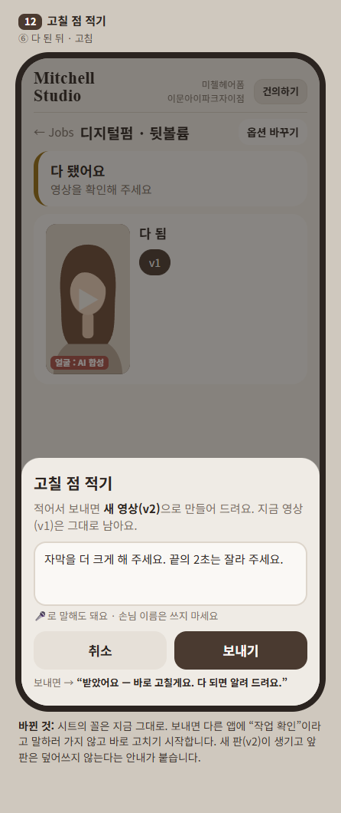

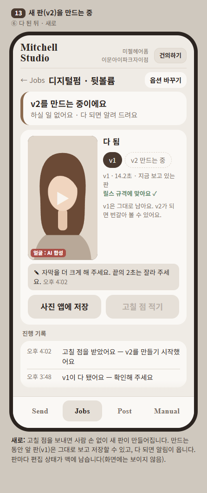

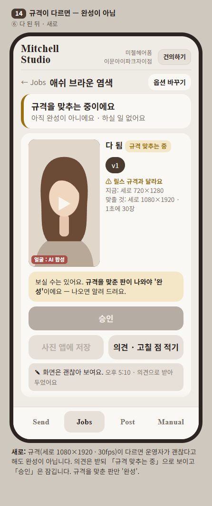

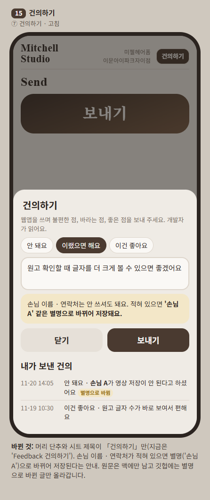

## 견줘 보기 — 탭 · 단계 이름

| 영어 (지금 웹앱 그대로) | 한글로 바꾼 꼴 |
|---|---|
|  | 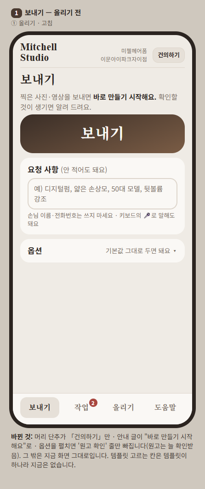 |
|  | 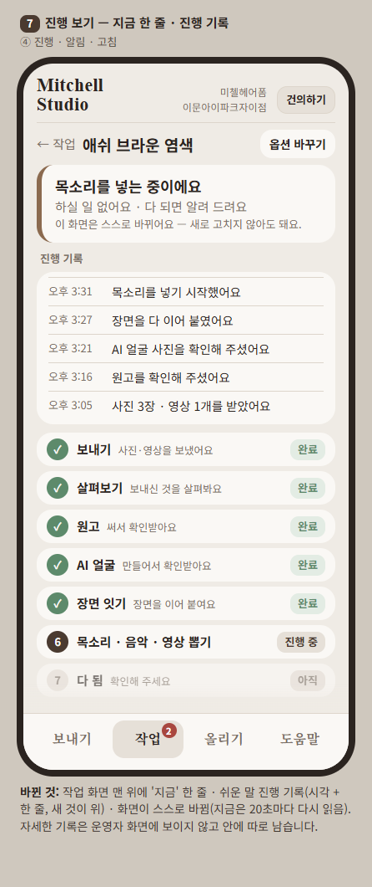 |
