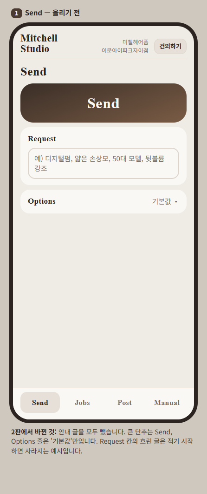
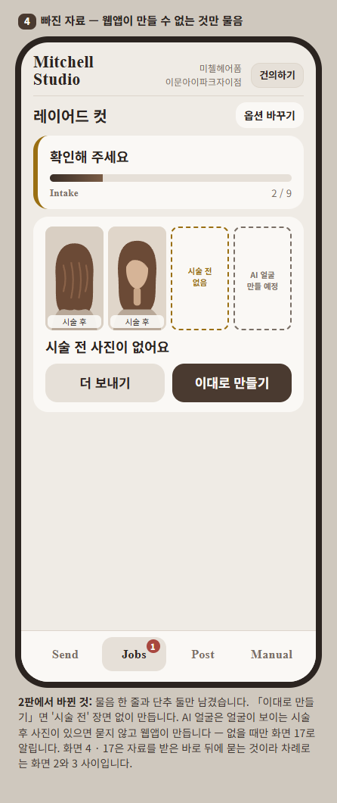
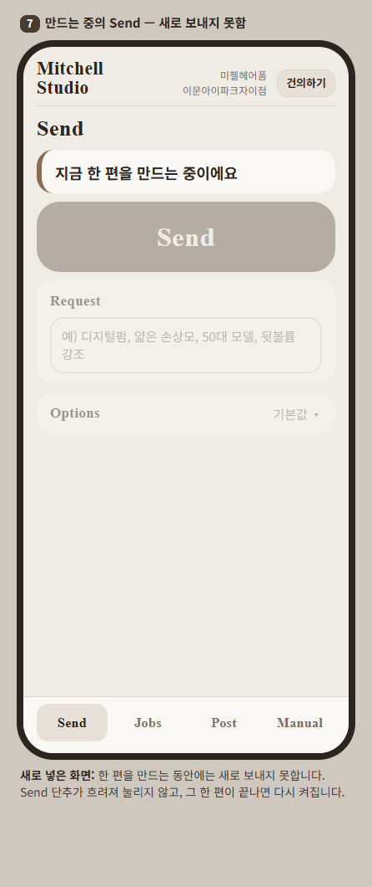
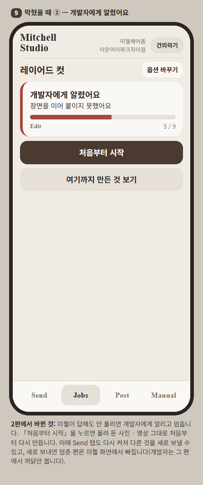
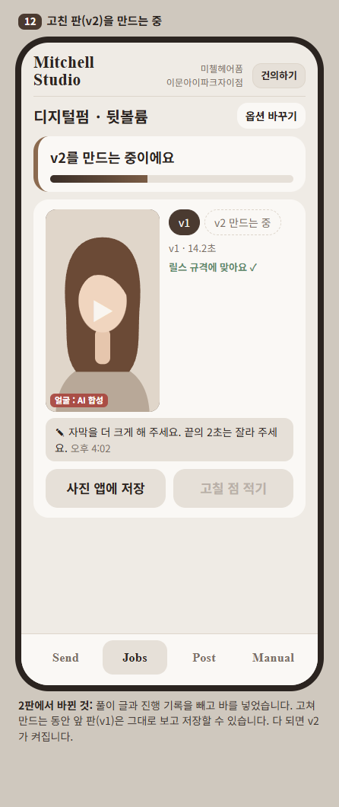
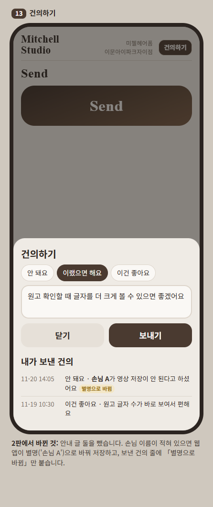

# 웹앱 1차 — 화면 시안 (3판)

## 2판에서 바꾼 것

1. 쓰는 사람은 **미첼**입니다 — 설명 글의 '운영자'를 모두 미첼로 바꿨습니다.
2. 화면 속 설명을 걷었습니다 — 화면에는 현황과 단추만 있습니다. 꼭 필요한 풀이 셋만 **? 표**로 남겼습니다(화면 5 · 11 · 13).
3. 이름은 영어 그대로입니다 — 큰 단추도 `Send`. 한글로 바꾼 꼴 견줘 보기는 뺐습니다.
4. 작업 목록을 없앴습니다 — Jobs에는 지금 만드는 한 편만, 만드는 중에는 하는 일 한 줄과 **프로그레스 바**만 보입니다(결과 칸도 없음). 만드는 동안에는 새로 보내지 못합니다(화면 7).
5. 알림 설명 화면을 뺐습니다 — 알림 켜는 법은 Manual 탭의 일입니다.

화면은 15개에서 14개가 됐습니다. 그림 속 작업 · 글 · 사람은 모두 지어낸 예시입니다.

