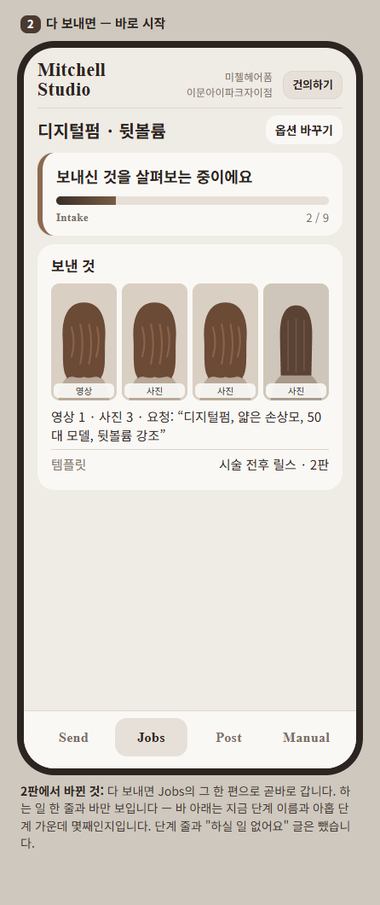
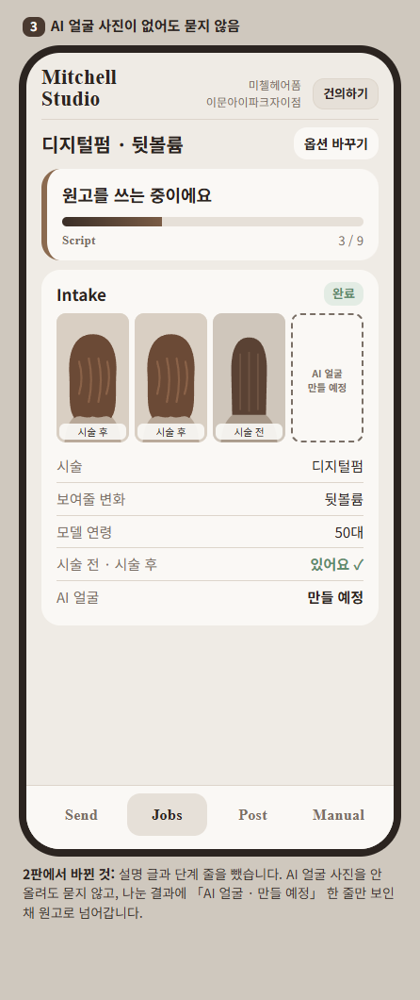
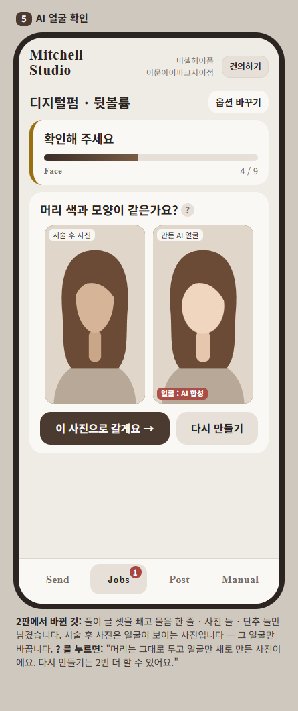
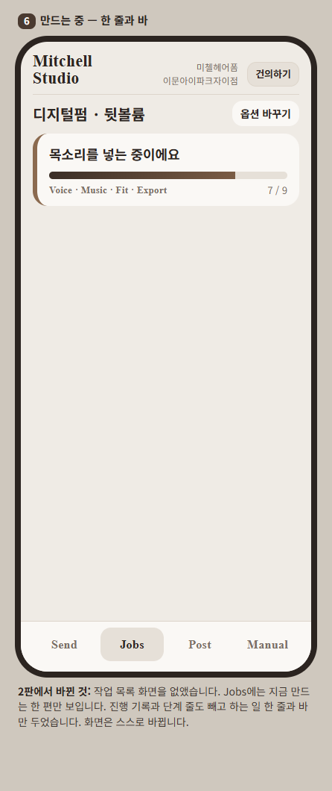
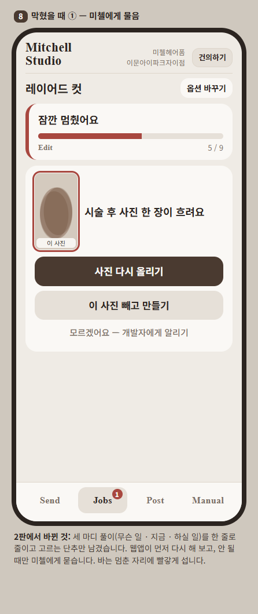
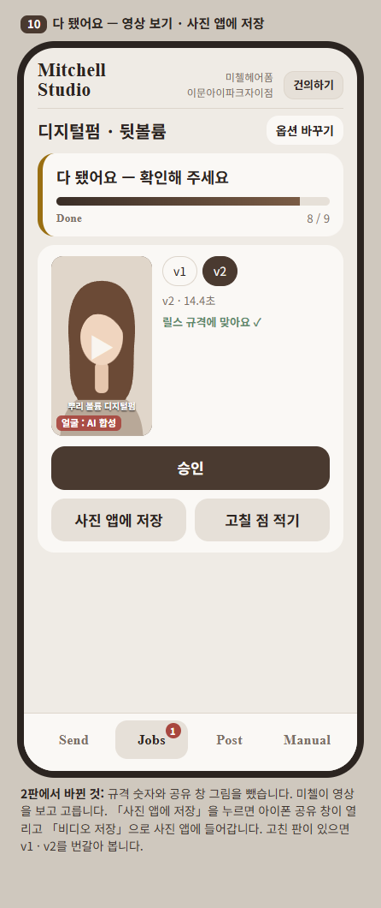
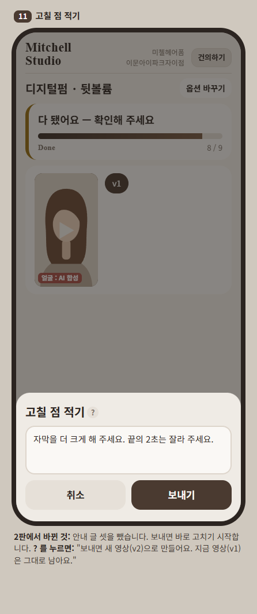
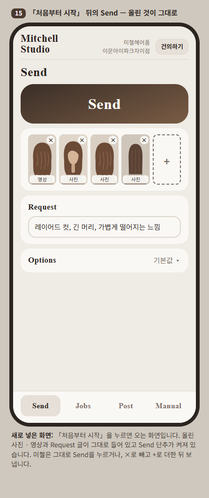
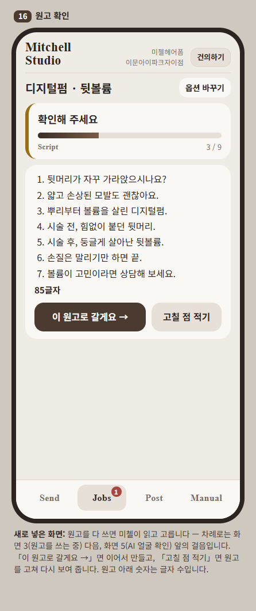
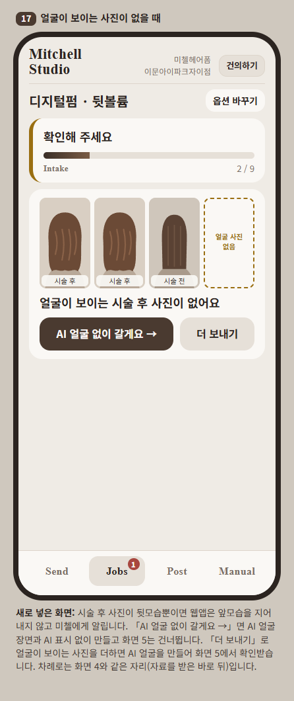

# 웹앱 1차 — 화면 시안 (3판)

## 2판에서 바꾼 것

1. 쓰는 사람은 **미첼**입니다 — 설명 글의 '운영자'를 모두 미첼로 바꿨습니다.
2. 화면 속 설명을 걷었습니다 — 화면에는 현황과 단추만 있습니다. 꼭 필요한 풀이 셋만 **? 표**로 남겼습니다(화면 5 · 11 · 13).
3. 이름은 영어 그대로입니다 — 큰 단추도 `Send`. 한글로 바꾼 꼴 견줘 보기는 뺐습니다.
4. 작업 목록을 없앴습니다 — Jobs에는 지금 만드는 한 편만, 만드는 중에는 하는 일 한 줄과 **프로그레스 바**만 보입니다(결과 칸도 없음). 만드는 동안에는 새로 보내지 못합니다(화면 7).
5. 알림 설명 화면을 뺐습니다 — 알림 켜는 법은 Manual 탭의 일입니다.
6. **「처음부터 시작」** 단추를 넣었습니다 — 개발자에게 넘어간 화면(화면 9)과 막힌 Send 화면(화면 7)에. 누르면 한 번 더 묻고 Send 화면으로 돌아가며, 올린 사진 · 영상과 요청 글은 그대로 들어 있습니다(화면 15).
7. **원고 확인** 화면을 더했습니다(화면 16) — 차례로는 화면 3(원고를 쓰는 중) 다음, 화면 5(AI 얼굴 확인) 앞의 걸음입니다. 미첼의 확인을 기다리는 화면은 4 · 5 · 8 · 10 · 16 · 17입니다.
8. **얼굴이 보이는 사진이 없을 때** 화면을 더했습니다(화면 17) — 웹앱은 앞모습을 지어내지 않고 미첼에게 알리며, 미첼이 확인하면 AI 얼굴 없이 만듭니다. 얼굴이 보이는 사진이 있으면 묻지 않고 웹앱이 AI 얼굴을 만듭니다(화면 3 · 5). 화면 4 · 17은 자료를 받은 바로 뒤에 묻는 것이라 차례로는 화면 2와 3 사이입니다.
9. 그림 속 **시술 후 사진**을 맞췄습니다 — 화면 5의 시술 후 사진은 얼굴이 보이는 앞모습이고, AI 얼굴은 머리는 그대로 두고 그 얼굴만 바꾼 것입니다. 화면 4 · 15의 작은 그림에도 얼굴이 보이는 시술 후 한 장이 있습니다.

화면은 17개입니다(2판에서 둘을 빼고 화면 7 · 15 · 16 · 17을 새로 넣음). 그림 속 작업 · 글 · 사람은 모두 지어낸 예시입니다.

한 편이 막힘 없이 가는 차례로 읽으면: 화면 1 → 2 → (물을 것이 있을 때만 4 · 17) → 3 → 16 → 5 → 6 → 10.

